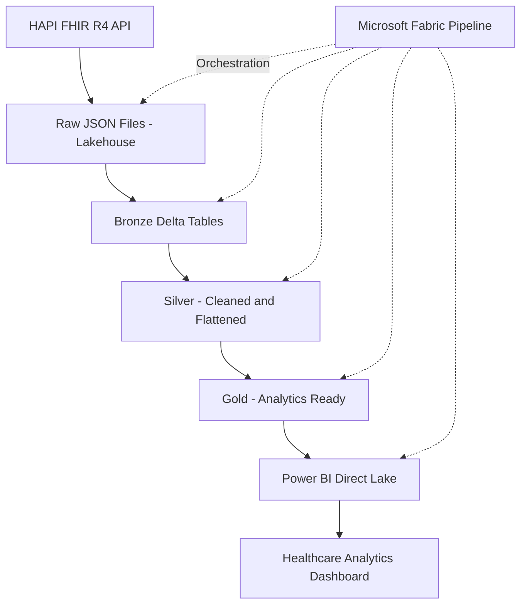
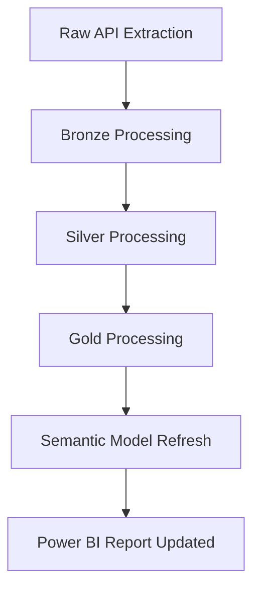

# FHIR Data Engineering Project – Microsoft Fabric

## 📌 Project Overview

This project demonstrates an end-to-end healthcare data engineering solution using Microsoft Fabric.

Healthcare data is ingested from a public FHIR R4 API, processed through a Medallion Architecture (Bronze, Silver, Gold), and made available for analytics through a Power BI Direct Lake report.

The project demonstrates API ingestion, data transformation, Delta Lake, SCD Type 2, pipeline orchestration, and reporting.

---

## 🏗️ End-to-End Architecture

---

## 🔗 Data Source

**Source:** HAPI FHIR R4 Public API

https://hapi.fhir.org/baseR4

### FHIR Resources

- Patient
- Encounter
- Observation
- Condition

---

## 🥉 Raw Layer

- Extracts data from the FHIR API.
- Handles API pagination.
- Stores raw JSON files in the Lakehouse.
- Maintains raw data for downstream processing.

---

## 🥉 Bronze Layer

- Loads raw JSON data into Delta tables.
- Preserves source-level data structures.
- Creates Bronze tables for each resource.

### Bronze Tables

- `bronze.Patient`
- `bronze.Encounter`
- `bronze.Observation`
- `bronze.Condition`

---

## 🥈 Silver Layer

- Flattens nested FHIR structures.
- Cleans and standardizes data.
- Removes duplicate records.
- Implements SCD Type 2 for historical tracking.
- Maintains record hash and effective date metadata.

### Silver Tables

- `silver.Patient`
- `silver.Encounter`
- `silver.Observation`
- `silver.Condition`

### SCD Type 2 Metadata

- `effective_start_date`
- `effective_end_date`
- `is_current`
- `scd_version`
- `record_hash`

---

## 🥇 Gold Layer

- Stores analytics-ready tables.
- Uses current records from Silver.
- Prepares datasets for reporting and analytics.

### Gold Tables

- `gold.Patient`
- `gold.Encounter`
- `gold.Observation`
- `gold.Condition`

---

## ⚙️ Pipeline Orchestration

The end-to-end pipeline is implemented using Microsoft Fabric Data Pipelines.

### Pipeline Name

`PL_FHIR_EndToEnd`

### Pipeline Execution Flow

1. Raw API Extraction
2. Bronze Processing
3. Silver Processing
4. Gold Processing
5. Semantic Model Refresh

Each stage executes sequentially, with downstream execution dependent on successful completion of the preceding stage.

### Pipeline Architecture

---

## 📊 Power BI Dashboard

A single-page healthcare analytics dashboard was developed using Power BI and a Direct Lake semantic model.

### KPI Metrics

- Total Patients
- Total Encounters
- Total Observations
- Total Conditions

### Dashboard Visuals

- Patients by Gender
- Encounters by Status
- Observations by Category
- Conditions by Clinical Status
- Patient Details

---

## 🔍 Data Quality Observations

The public FHIR API contains independently generated resource records, which can result in patient references that do not match records in the Patient dataset.

The project identifies and retains these data quality observations rather than artificially forcing reference matches.

This demonstrates real-world data quality assessment and handling of source-system inconsistencies.

---

## 🛠️ Technology Stack

| Technology | Purpose |
|---|---|
| Microsoft Fabric | Data Engineering Platform |
| Fabric Data Pipelines | Pipeline Orchestration |
| Fabric Notebooks | Data Processing |
| Lakehouse | Data Storage |
| Delta Lake | Storage Format |
| PySpark | Data Transformation |
| Python | API Ingestion |
| FHIR R4 API | Source System |
| Power BI | Data Visualization |
| Direct Lake | Analytics Connectivity |
| SCD Type 2 | Historical Data Tracking |
| Medallion Architecture | Data Architecture |

---

## 🎯 Project Objectives

- Build an end-to-end API ingestion pipeline.
- Implement Medallion Architecture.
- Process data using PySpark.
- Implement SCD Type 2.
- Store data using Delta Lake.
- Orchestrate workloads using Microsoft Fabric Data Pipelines.
- Automate semantic model refresh.
- Develop a Power BI healthcare analytics dashboard.
- Identify source data quality issues.

---

## 👨‍💻 Author

**Vivek Bhosale**

GitHub: [vivekbhosale003](https://github.com/vivekbhosale003)

Repository: [FHIR-Data-Engineering](https://github.com/vivekbhosale003/FHIR-Data-Engineering)
